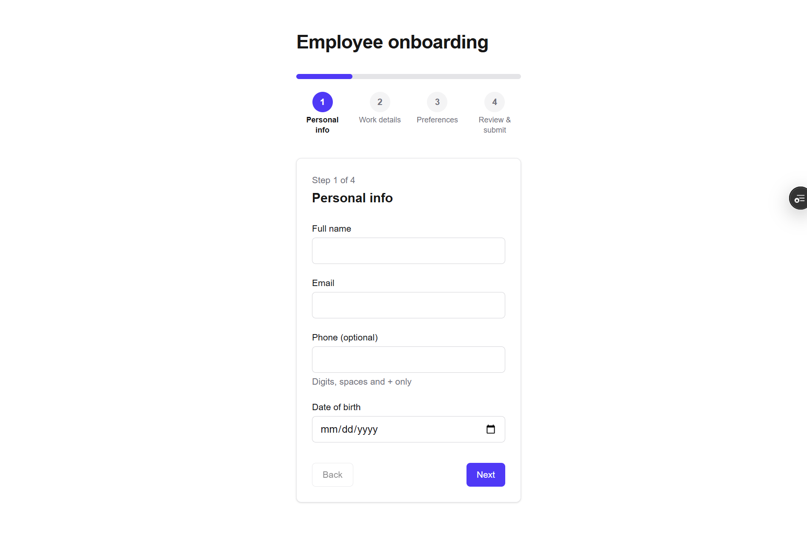

# Onboarding Form

A multi-step employee onboarding form with per-step Zod validation, conditional fields, saved progress and a review screen.

**Live:** https://onboarding-form-git-main-kats-projects-576abbd6.vercel.app/
**Repo:** https://github.com/redKath/onboarding-form



## Stack

- Next.js (App Router) + TypeScript (strict)
- Tailwind CSS
- react-hook-form + Zod (`@hookform/resolvers/zod`)
- ESLint + Prettier
- No backend or database: all data stays in the browser

## Features

- **Per-step Zod validation:** one schema per step, combined into a full schema; types come from `z.infer`. Inline errors, and focus moves to the first invalid field.
- **Conditional fields:** contract end date (Contract only, must be after the start date) and preferred office (Hybrid or Onsite).
- **Persistence:** progress and current step are saved to `localStorage`, restored on refresh, and cleared on submit or "Start over".
- **Review and edit:** read-only summary grouped by step with an Edit link per group, a full-schema check on submit, and a copyable JSON result.
- **Accessibility:** labels tied to inputs, `aria-invalid` and `aria-describedby` for errors, keyboard navigation, visible focus states.
- **Responsive:** works from 375px phones to desktop.

## Run locally

```bash
npm install
npm run dev
```

Open http://localhost:3000.

Other scripts: `npm run build`, `npm run lint`, `npm run format`.

## Project structure

```
app/                  Next.js App Router entry
components/form/      Stepper, field components, step forms, review and success screens
components/ui/        Shared UI primitives
lib/schemas/          Zod schemas per step and the combined schema
lib/storage.ts        localStorage load/save/clear
```

Built with Claude Code; all code reviewed and tested manually.
